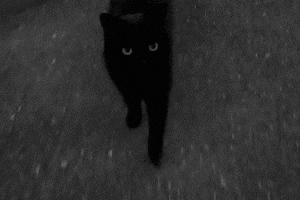

# 𝕽𝖆𝖉𝖎𝖔𝕮𝖚𝖇𝖔

*“Somewhere between logic and darkness.”*

  
  &nbsp;&nbsp;
  

✦ ─────────────── 🩸 ─────────────── ✦

**ADS Student · Aspiring Developer · Artist**

---

### 𖤐 About me

Hello, I'm **Thali** — a student of Systems Analysis and Development, learning to turn ideas into code.

- 🇧🇷 From Brazil
- Currently learning **Python**, **Java**, and web development.
- Interested in software development, dark fantasy, and creative storytelling.
- I draw, play guitar, and create fictional worlds.
- Always learning, experimenting, and building something new.

### ⚰️ The diary

Here are some of the things I'm learning and working on:

- `Python` — logic, functions, and problem solving.
- `Java` — object-oriented programming and application development.
- `HTML & CSS` — building and styling web pages.
- `Back-End` — learning server-side logic and how applications work behind the scenes.
- `Git & GitHub` — version control and documenting my journey.

### 🥀 Beyond the code

Drawing · Metalhead (but I listen to all kinds of music) · RPGs · Gaming (Overwatch, Digimon, Pokémon, and Soulslikes)

---

*𝔐emento mori.*

Made with curiosity, caffeine, and a little darkness.

  

